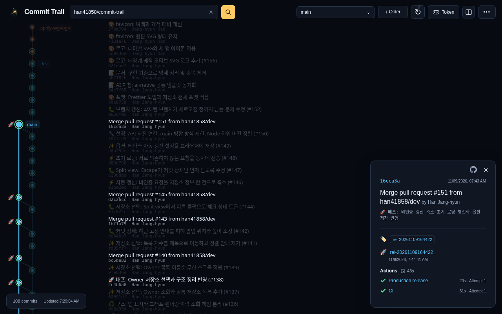
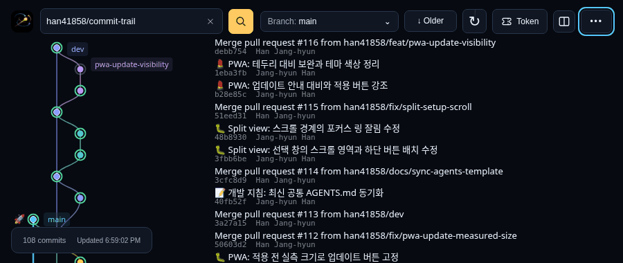
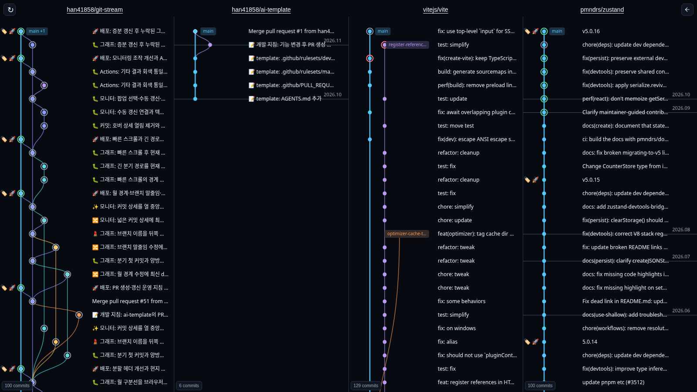
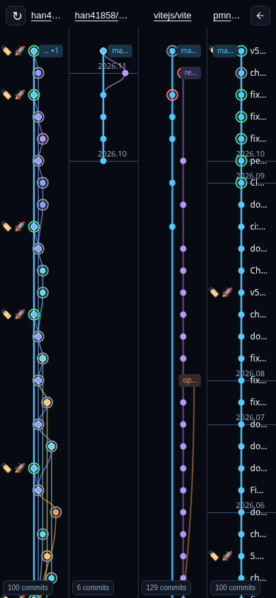
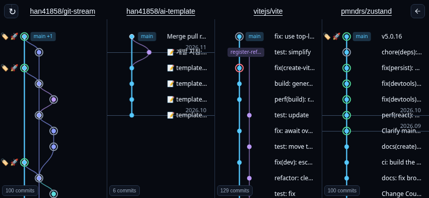

<p align="center">
  
</p>

<h1 align="center">GitStream</h1>

<p align="center">
  <a href="LICENSE.md"></a>
  <a href="https://github.com/han41858/git-stream/releases"></a>
</p>

<p align="center"><strong>Watch your Git history unfold.</strong></p>
<p align="center">Explore GitHub history directly in your browser.</p>
<p align="center">Read-only · Web app · PWA</p>

<p align="center">
  <a href="https://git-stream-view.vercel.app/?repo=han41858%2Fgit-stream"><strong>Live Demo</strong></a>
  · <a href="#getting-started">Get started</a>
  · <a href="#development--documentation">Documentation</a>
</p>



## Features

- **Follow branches and merges** in an interactive, vertical Git graph.
- **Stay current** with automatic updates that preserve your place while reading.
- **Split view** puts 1–4 repositories in one row, with independent graphs and scrolling on a shared refresh schedule.
- **See the context** with tags, releases and GitHub Actions status beside commits.
- **Explore public and private repositories**, with optional GitHub token access.
- **Use it anywhere** on desktop or mobile, or install it as a PWA.

<details>
<summary>See automatic refresh in action</summary>



</details>



Choose **Split view** to select and reorder repositories. Inspect commits and GitHub Actions in any column, then use **Copy link** in the selection dialog to share the arrangement.

<table>
  <tr><th>Portrait</th><th>Landscape</th></tr>
  <tr>
    <td width="28%" align="center" valign="top"></td>
    <td width="72%" align="center" valign="top"></td>
  </tr>
</table>

Portrait Split view emphasizes the DAG. Landscape can show one-line commit messages when column width and lane spacing allow; tap a node for full details in either orientation. The same layout works in the browser and installed PWA.

*Actual browser captures with public GitHub data. Mobile uses viewport emulation. [Capture details](docs/images/README.md).*

## Getting started

1. Open the [Live Demo](https://git-stream-view.vercel.app/?repo=han41858%2Fgit-stream).
2. Enter `owner/repo` or a GitHub repository URL and press Enter.
3. Choose a branch, scroll through history and select a commit for details.

Use **Options** to choose a theme and refresh interval. Install GitStream from your browser's app menu or add it to your home screen. The PWA caches the app shell; GitHub data still needs a connection.

Shared links restore the view when opened or reloaded, with repositories arranged left to right in URL order:

| Query | View |
| --- | --- |
| `?repo=owner/repo` | Single repository |
| `?repo=owner/repo&repo=other/repo` | Two-repository Split view |
| `?repo=owner/repo&mode=monitor` | One-repository Split view |

Links contain no PAT, but **private repository names are visible in the URL**. Access still uses the recipient's own token. See the [Split view guide](docs/monitor-mode.md) for details.

### Private repositories and API limits

Public repositories work without a token. For private repositories or higher API limits, create a **fine-grained personal access token** for the repositories you choose, then apply it in **Token**.

| Permission | Access | Used for |
| --- | --- | --- |
| Contents | Read-only | Commits, branches, tags and releases |
| Pull requests | Read-only | PR-based branch suggestions |
| Actions | Read-only | Workflow runs and jobs |

The token is saved in this browser's localStorage and sent only to `api.github.com`. **Remove token & clear history** removes the saved token and displayed history. See the [technical guide](docs/technical-guide.md#use) for access checks, rate limits and storage behavior.

## Development & documentation

Use **Node.js 24.x** and npm:

```sh
npm ci
npm run dev
```

- [Technical guide](docs/technical-guide.md) — usage, architecture, API behavior, tests, deployment and releases.
- [Product specification](docs/specification.md) · [Refresh and metadata](docs/auto-refresh-and-metadata.md) — implementation specifications.
- [PWA](docs/pwa.md) · [Developer diagnostics](docs/developer-debug-mode.md) — installation, updates, recovery and local measurements.
- [Recent repositories](docs/recent-repositories.md) — local suggestions, deletion and PAT changes.
- [Split view](docs/monitor-mode.md) — selection and ordering, shared URLs, refresh and mobile limits.

Ideas and bug reports are welcome in [Issues](https://github.com/han41858/git-stream/issues).

## License

[MIT](LICENSE.md) © 2026 Han Jang-hyun.
