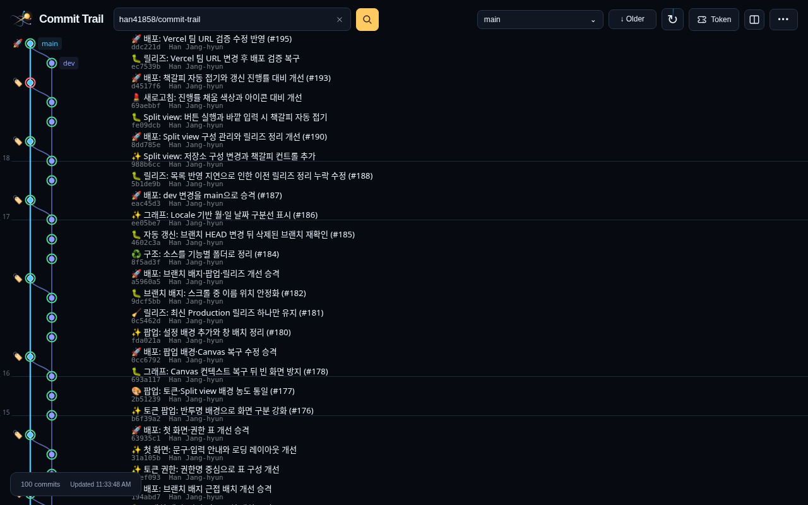
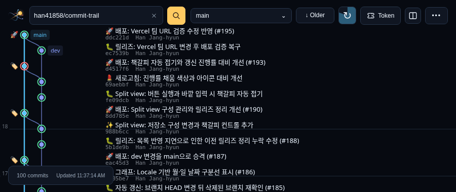
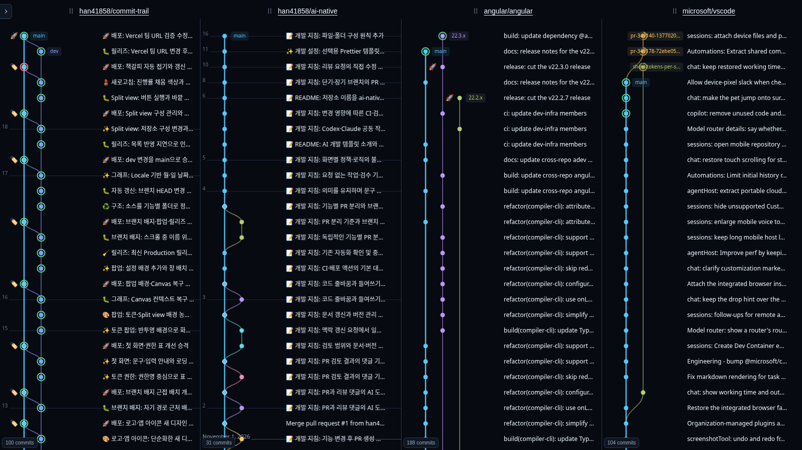
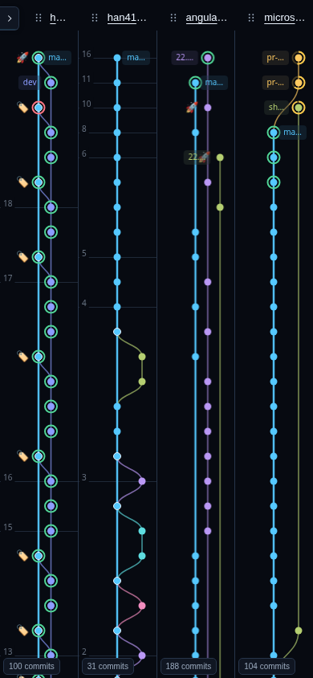
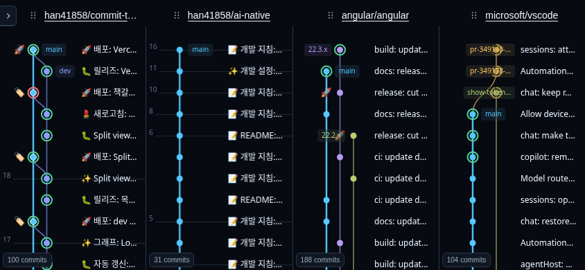

<p align="center">
  <picture>
    <source media="(prefers-reduced-motion: reduce) and (prefers-color-scheme: light)" srcset="assets/logo-light.svg" />
    <source media="(prefers-reduced-motion: reduce)" srcset="assets/logo.svg" />
    <source media="(prefers-color-scheme: light)" srcset="assets/logo-light-animated.svg" />
    <source media="(prefers-color-scheme: dark)" srcset="assets/logo-animated.svg" />
    
  </picture>
</p>

<h1 align="center">Commit Trail</h1>

<p align="center">
  <a href="LICENSE.md"></a>
  <a href="https://github.com/han41858/commit-trail/releases"></a>
</p>

<h3 align="center">Follow your commit trail.</h3>
<p align="center">Explore GitHub history directly in your browser.</p>
<p align="center">Read-only · Web app · PWA</p>

<p align="center">
  <a href="https://commit-trail-view.vercel.app/?repo=han41858%2Fcommit-trail"><strong>Live Demo</strong></a>
  · <a href="#getting-started">Get started</a>
  · <a href="#development--documentation">Documentation</a>
</p>



## Features

- **Follow branches and merges** in an interactive, vertical Git graph. Hover or select a [branch path](docs/dag-hover-highlight.md) to follow its history, and select a commit for details.
- **Read the timeline** with month and day separators formatted for your locale.
- **Stay current** with automatic updates that preserve your place while reading.
- **Split view** puts 1–32 repositories in one row, with independent graphs and scrolling on a shared refresh schedule.
- **See the context** with tags, releases and GitHub Actions status beside commits.
- **Find repositories by owner**: enter a GitHub user or organization name to browse repositories, or keep using `owner/repo` and repository URLs directly. Public repositories and those accessible with your applied token appear together.
- **Use it anywhere** on desktop or mobile, or install it as a PWA.

<details>
<summary>See automatic refresh in action</summary>



</details>



Choose **Split view** to select repositories. While viewing, open the `>` tab on the left to refresh, **Manage repositories**, or **Return to single view**. Choose **Manage repositories**, edit the list, then **Apply changes**. Repositories that stay in the view keep their scroll position and selection.

Drag a header handle to reorder columns; on touch screens, press and hold it first. Inspect commits and GitHub Actions in any column, or use **Copy link** in the selection dialog to share the arrangement.

<table>
  <tr><th>Portrait</th><th>Landscape</th></tr>
  <tr>
    <td width="28%" align="center" valign="top"></td>
    <td width="72%" align="center" valign="top"></td>
  </tr>
</table>

Portrait Split view emphasizes the DAG. Landscape can show one-line commit messages when column width and lane spacing allow; tap a node for full details in either orientation. The same layout works in the browser and installed PWA.

_Actual browser captures with public GitHub data. Mobile uses viewport emulation. [Capture details](docs/images/README.md)._

## Getting started

1. Open the [Live Demo](https://commit-trail-view.vercel.app/?repo=han41858%2Fcommit-trail).
2. Enter `owner/repo` or a GitHub repository URL and press Enter. Or enter just an owner, such as `han41858`, then choose a repository from the list.
3. Choose a branch, scroll through history and select a commit for details.

Submit an owner to browse its repositories in A–Z order, then filter the loaded list or use **Load more**. In Split view, check multiple repositories and choose **Add N repositories**. See the [owner selection guide](docs/owner-repositories.md) for access, filtering and pagination details.

Commit Trail remembers the last branch you choose for each repository in this browser. An explicit `branch` in a shared URL takes priority for that visit without changing your saved choice; otherwise it restores your choice, then falls back to `main`, `master`, or the repository default.

Use **Options** to choose a theme and refresh interval; your choices are remembered in this browser. Install Commit Trail from your browser's app menu or add it to your home screen. The PWA caches the app shell; GitHub data still needs a connection.

Shared links restore the view when opened or reloaded, with repositories arranged left to right in URL order:

| Query                                                     | View                                         |
| --------------------------------------------------------- | -------------------------------------------- |
| `?repo=owner/repo`                                        | Single repository                            |
| `?repo=owner/repo&branch=Feature%2FFix`                   | Single repository on `Feature/Fix`           |
| `?repo=owner/repo&repo=other/repo`                        | Two-repository Split view                    |
| `?repo=owner/repo&repo=other/repo&branch=main&branch=dev` | Split view on `main` and `dev`, respectively |
| `?repo=owner/repo&mode=monitor`                           | One-repository Split view                    |

**Copy link** includes confirmed current branches in repository order. Repeated `branch` values match repeated `repo` values by position; use an empty `branch=` for an unspecified middle repository. Links contain no PAT, but **private repository and branch names are visible in the URL**. Access still uses the recipient's own token. See the [Split view guide](docs/monitor-mode.md) for details.

### Private repositories and API limits

Public repositories work without a token. For private repositories or higher API limits, create a **fine-grained personal access token** for the repositories you choose, then apply it in **Token**.

| Permission    | Access    | Used for                             |
| ------------- | --------- | ------------------------------------ |
| Actions       | Read-only | Workflow runs and jobs               |
| Contents      | Read-only | Commits, branches, tags and releases |
| Pull requests | Read-only | PR-based branch suggestions          |

The token is saved in this browser's localStorage and sent only to `api.github.com`. **Remove token & clear history** removes the saved token and displayed history. See the [technical guide](docs/technical-guide.md#use) for access checks, rate limits and storage behavior.

## Development & documentation

Use **Node.js 24.x** and npm:

```sh
npm ci
npm run dev
```

- [Documentation map](docs/README.md) — document roles, implementation references and maintenance rules.
- [Development and operations guide](docs/technical-guide.md) — local development, architecture, CI, AI automation and Vercel deployment.
- [Product specification](docs/specification.md) · [Refresh and metadata](docs/auto-refresh-and-metadata.md) — implementation specifications.
- [PWA](docs/pwa.md) · [Developer diagnostics](docs/developer-debug-mode.md) — installation, updates, recovery and local measurements.
- [Owner selection](docs/owner-repositories.md) — repository lookup, access, filtering and pagination.
- [Recent repositories](docs/recent-repositories.md) — local suggestions, deletion and PAT changes.
- [Split view](docs/monitor-mode.md) — selection and ordering, shared URLs, refresh and responsive layout.

Ideas and bug reports are welcome in [Issues](https://github.com/han41858/commit-trail/issues).

## License

[MIT](LICENSE.md) © 2026 Han Jang-hyun.
